### Hi there,  👋

Welcome to my profile :)

Below is a brief summary of my professional moment:
- 🔭 I’m currently working on Salesforce development ecossystem (Apex, LWC, Visualforce and B2C Commerce Cloud)
- 🌱 I’m currently learning Javascript, CSS and Front End topics
- 🔬 Searching the blockchain's dynamics, especially smart contracts
- 🤝 I’m looking to collaborate on integrating Salesforce solution to AI and Web3
##

  
  

##

    

    
    
    
    
    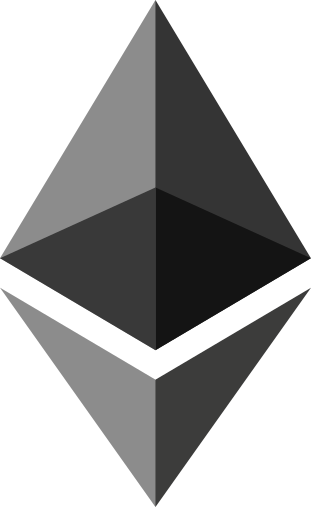    

      

##

    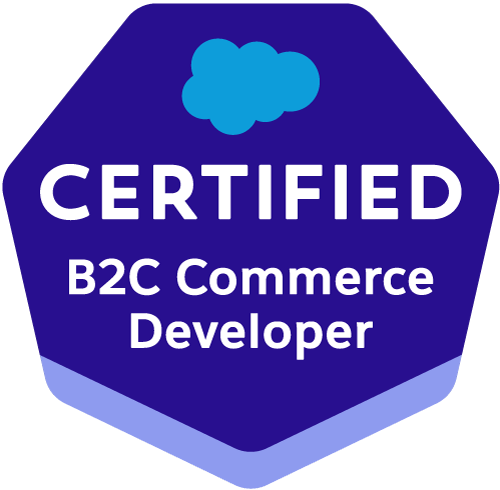
    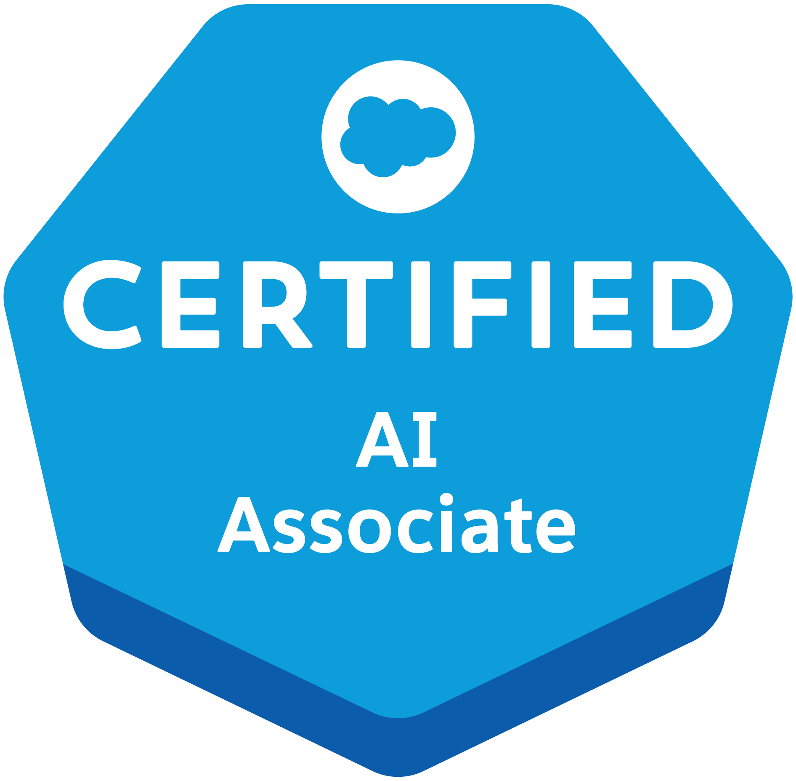
    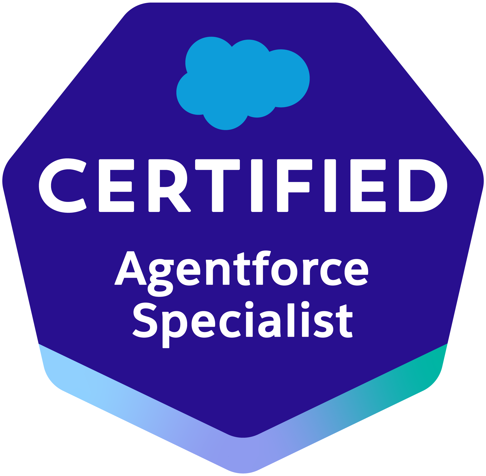
    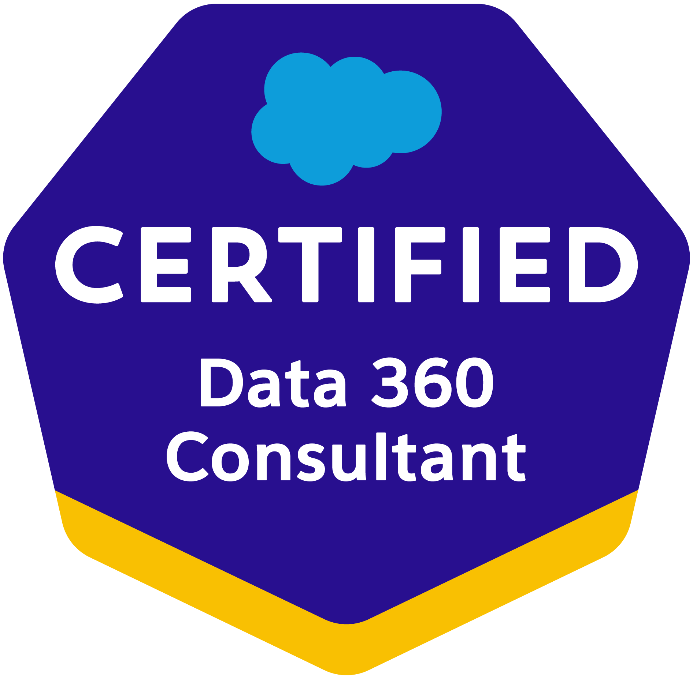
    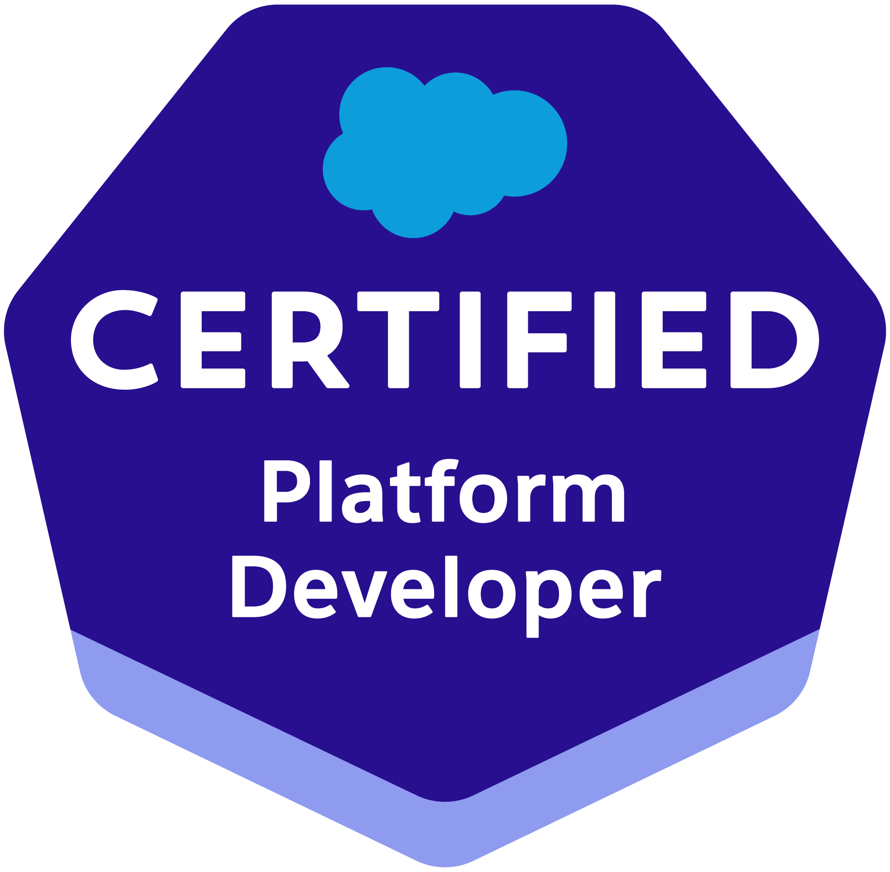 
    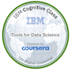
    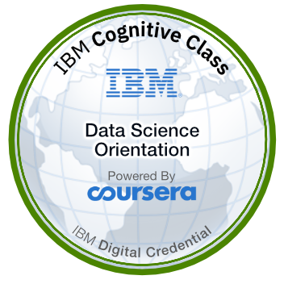
    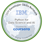
    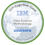
    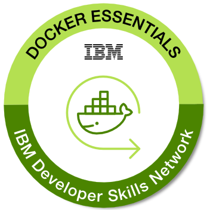

<!--
**csilva86/csilva86** is a ✨ _special_ ✨ repository because its `README.md` (this file) appears on your GitHub profile.

Here are some ideas to get you started:

- 🔭 I’m currently working on ...
- 🌱 I’m currently learning ...
- 👯 I’m looking to collaborate on ...
- 🤔 I’m looking for help with ...
- 💬 Ask me about ...
- 📫 How to reach me: ...
- 😄 Pronouns: ...
- ⚡ Fun fact: ...
-->

